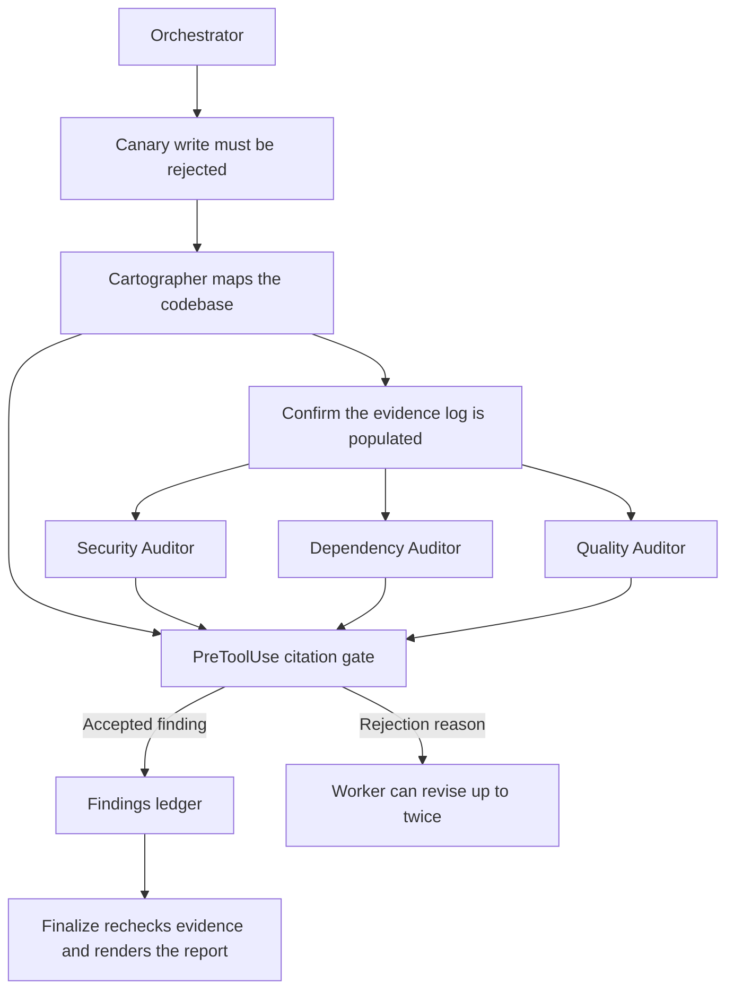

# Ghost in the Audit

**A Kiro audit team that shows its evidence.**

Opening an unfamiliar codebase can feel like walking into a haunted house. Ghost in the Audit sends four Kiro specialists through a local copy of the code. A finding enters the report only when its citations match lines that a Kiro tool actually read.

## Quick start

You need Kiro IDE or Kiro CLI V3 and Python 3.9+ on macOS or Linux. The auditor scripts use the Python standard library. You do not need to install or run the sample project's dependencies.

```sh
git clone https://github.com/Conly-Zy/ghost-in-the-audit.git
cd ghost-in-the-audit
python3 dev/check_workspace.py
cp -R dev/e2e-sample-target targets/pinger-demo
```

Use `pinger-demo` as a new directory name. If it already exists, choose a new name and use it in the audit request.

- **Kiro IDE.** Open the repository root, start a fresh chat, and select `orchestrator` in the agent picker.
- **Kiro CLI V3.** From the repository root, start `kiro-cli chat --agent orchestrator`. CLI compatibility is still being verified.

Send this in the session:

```text
Audit the pinger-demo directory under targets/.
```

In the tool activity, look for the deliberate `CITATION_MISSING` rejection before the first worker starts. After a completed run, open `runs/<run-id>/report.md` and `report.json`. Use the run ID the orchestrator returned to check them:

```sh
python3 dev/verify_e2e_report.py runs/<run-id> --require-all-dispatched
```

Replace `<run-id>` with the actual directory name. Keep the target copy unchanged until verification completes. Put other codebases under `targets/<name>/` and start with a fresh Kiro session. The toolkit allows one active audit per workspace. The [live runbook](docs/e2e-runbook.md) covers setup, expected results, and troubleshooting.

## What Kiro does



- **Workspace agents** divide the investigation into code structure, security, dependencies, and quality. The orchestrator checks the evidence recorder after the Cartographer returns, then dispatches the three domain specialists and waits for their results before finalizing. It assembles the report from the findings ledger.
- **`PostToolUse`** records lines returned by supported read tools. Each entry carries a target-relative path, a line range, a UTC timestamp, and a content hash.
- **`PreToolUse`** checks every proposed inbox write. The gate verifies the citation's location, evidence timestamp, excerpt, and current file contents. A rejection goes back to the submitting agent with a reason code. The deliberate canary rejection verifies that this path is active.
- **Kiro Specs and steering** define the audit protocol and the shared evidence contract. Source code, comments, and tool results from the target are treated as data throughout the review.

### Anatomy of a citation

| Field | Meaning |
| --- | --- |
| `location` | A path and line number or range, relative to the target root |
| `evidence_timestamp` | The UTC time the recorder assigned to the tool read, copied from `evidence.jsonl` |
| `excerpt` | Text from the cited lines, checked against the returned evidence and current file |

The citation demonstrates that the cited lines were observed and still match at report generation. The interpretation of those lines requires review. Audits use static reads and do not execute target code or query vulnerability databases. Unsupported read responses produce no evidence for those reads. The `agent` field is self-reported.

## Reproduce the gate without Kiro

```sh
python3 -m unittest tests.test_observed_payload.TestObservedPayloadEndToEnd -v
python3 -m unittest discover -s tests -t .
python3 dev/sync_evidence_rules.py --check
```

The first command drives the real Hook scripts with replayed IDE-shaped payloads. It checks canary rejection, reading at a nonzero offset, rejecting an invalid excerpt, accepting a cited finding, and verifying the final report. IDE probes have confirmed that subagent tool calls reach the Hooks. Full live IDE and CLI runs are pending. See the [platform observations](docs/platform-notes.md).

## Repository layout

| Path | Purpose |
| --- | --- |
| `.kiro/agents/` | Orchestrator and four specialist profiles |
| `.kiro/hooks/`, `.kiro/scripts/` | Tool hooks, evidence logging, citation checks, and reports |
| `.kiro/specs/`, `.kiro/steering/` | Requirements, design, tasks, and shared evidence rules |
| `dev/e2e-sample-target/` | Small sample codebase for the live demo |
| `dev/verify_e2e_report.py`, `tests/` | Report verifier and automated tests |
| `targets/`, `runs/`, `control/` | Local target copies, audit outputs, and control requests |

Development and submission steps are tracked in the [Kiroween runbook](docs/kiroween-submission.md).

## License

[MIT](LICENSE)
